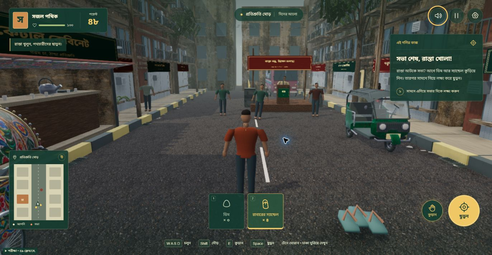
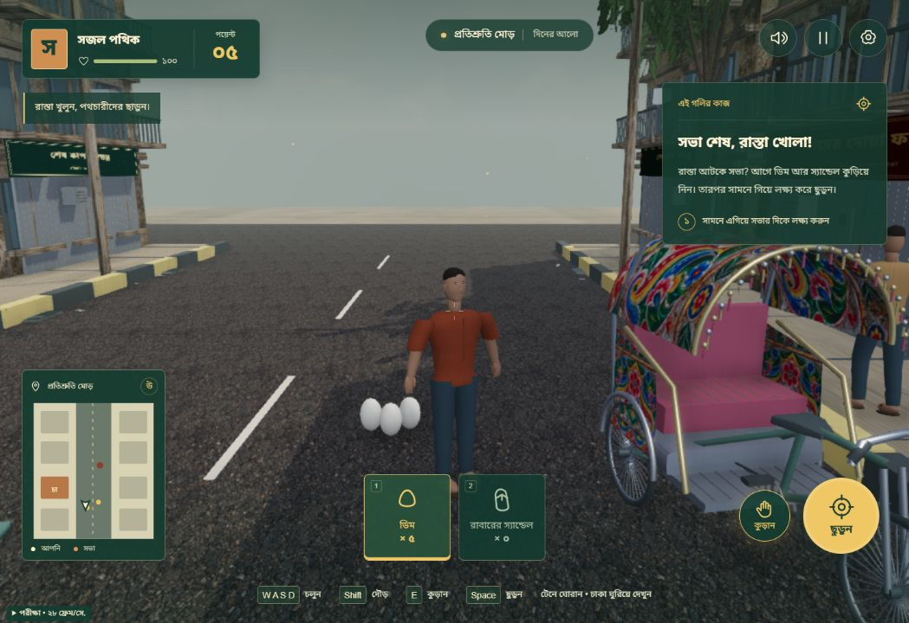
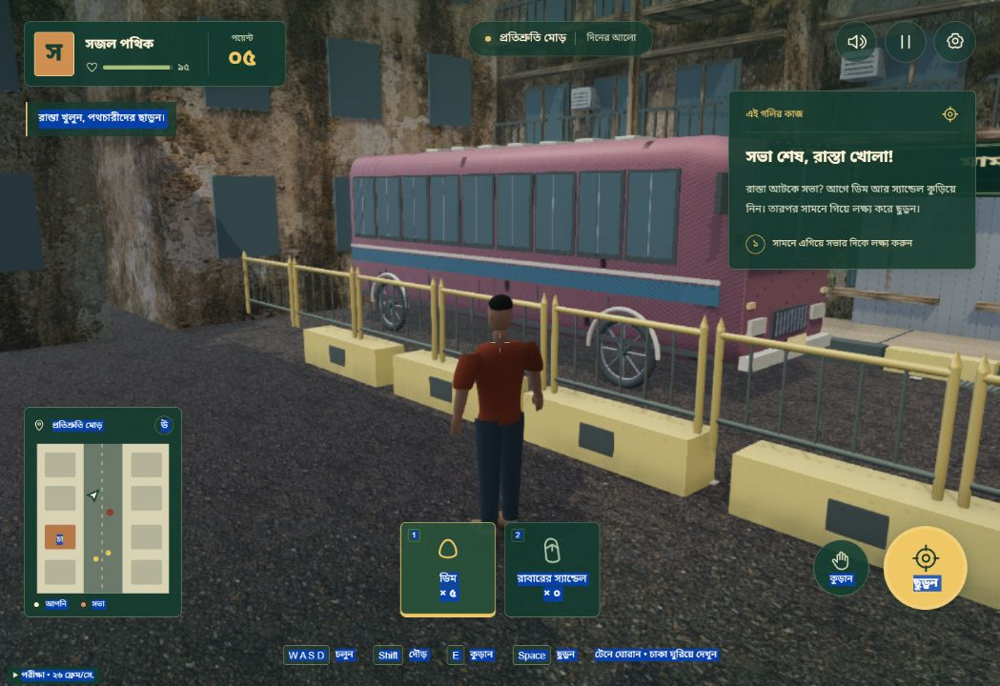

# ছবি-ভিত্তিক গ্রাফিক্স সংশোধন — ২ নভেম্বর ২০২৬

আপনার দেওয়া ঢাকার ছবির গঠন, উপকরণ ও রঙ অনুসরণ করে বর্তমান এক-ব্লকের খেলায় যানবাহন, রাস্তা, পরিবেশ ও অ্যানিমেটেড চরিত্র উন্নত করা হয়েছে। এটি Phase 01-এর সংশোধন; পূর্ণ শহর, গাড়ি চালানো, Admin বা multiplayer তৈরি করা হয়নি। চূড়ান্ত semi-realistic শিল্পমানের অনুমোদন এখনো খোলা।

খেলুন: [স্থানীয় গেম](http://127.0.0.1:4173/)। আগের সংস্করণের backup: `assets/source/archive/phase01-before-photo-upgrade.zip`। মূল ছবিগুলো অপরিবর্তিত রয়েছে।

## দৃশ্যের পরিবর্তন

| অংশ | বর্তমান বাস্তবায়ন |
| --- | --- |
| রিকশা | বাঁকানো ছাউনি, floral tin artwork, brass trim, ঝালর, লাল আসন, tube frame, chain/crank/pedal, চাকার spokes ও mudguard |
| সিএনজি | সবুজ ক্ষয়ধরা enamel, খোলা cabin/bench, বাঁকানো সামনের panel, windshield/wiper, lights, mirrors, step ও safety rail |
| বাস | গোল কোণসহ body, sliding window frames, roof vents, grille/wiper/mirrors, গোলাপি-নীল স্থানীয় রঙ; কাল্পনিক বাংলা পরিচয় |
| রাস্তা ও ভবন | asphalt color/normal/ORM, মলিন plaster, পানি জমার সঠিক surface normals, নালা/grate, হলুদ railing, fictional বাংলা posters, service meters, utility conduits ও পাতাযুক্ত গাছ |
| আলো | স্থানীয় HDR sky/environment reflections; desktop contact shading; mobile preset-এ অতিরিক্ত AO বন্ধ |
| মানুষ | সংশোধিত মুখ/হাত/পা, কাপড়ের বুনন/folds, collar/pocket/buttons; পাঞ্জাবি/কামিজ/ওড়না, চুল/গোঁফ ও মাপের ভিন্নতা |
| অ্যানিমেশন | ১৭-joint original rig; Idle, Walk, Run, Throw, Hit, Pickup; NPC sidewalk হাঁটা ও আলাদা phase; ১০ skeleton, ৬০ cloned clip groups |
| ক্যামেরা | নিচু street-level view, drag orbit, obstruction retraction; mouse-wheel zoom ১.৮–৬.৫ মিটার implemented |

উৎস: `apps/game/src/vehicles.ts`, `sceneDetails.ts`, `characterStyle.ts`, `world.ts`, `art.ts`, `game.ts`, `engine.ts` এবং `assets/source/generate.mjs`। GLB ৯৩০,৭৬০ bytes। পোশাক একই skeleton-এর skin weights ব্যবহার করে।

## ছবির ব্যবহার ও সম্পদের উৎস

১১টি reference-এর dimensions, SHA-256 ও নির্দিষ্ট ভূমিকা: [manifest](../assets/source/references/manifest.json) এবং [art direction](context/002-reference-art-direction.md)। ছবি থেকে geometry reconstruction বা মানুষের মুখ বসানো হয়নি। বাস্তব রাজনৈতিক প্রতিকৃতি ও প্রতিষ্ঠান/দলীয় logo প্রকাশ করা হয়নি।

**Built-in imagegen** দিয়ে reference-inspired material atlas তৈরি হয়েছে: [মূল atlas](../assets/source/generated/dhaka-surface-atlas-v2.png), [ঠিক ব্যবহৃত prompt ও mode](../assets/source/generated/prompts.md)। চার material-এর ১২টি local color/normal/ORM map মোট প্রায় ৩.১ MB। Normal/ORM luminance থেকে অনুমান করা; measured scan নয়।

HDR sky: Greg Zaal/Jarod Guest-এর [Poly Haven asset](https://polyhaven.com/a/kloofendal_48d_partly_cloudy_puresky), [CC0](https://polyhaven.com/license)। স্থানীয় metadata: `assets/source/generated/environment-provenance.json`। বিস্তারিত [ASSETS.md](../ASSETS.md)। সব runtime asset স্থানীয়ভাবে সরবরাহ হয়।

## যাচাইয়ের ফল

- সর্বশেষ gameplay source পরিবর্তনের পরে `npm run verify`: types, lint, **৬/৬ tests** ও production build পাস। [মূল output](evidence/graphics-v2-checks.txt)। Tests rig/clips/normalized skin weights, material/download budget, Unicode, collision ও ballistic rules পরীক্ষা করে।
- Chrome-এ বাস্তব rendering এবং ৩৯০×৮৪৪ responsive viewport পরীক্ষা হয়েছে। ছোট পর্দায় scrollWidth=৩৯০; Bengali settings, HUD, mini-map ও touch controls দেখা হয়েছে। Mobile preset-এ HDR ready এবং AO=false; desktop-এ AO=true।
- Touch joystick দিয়ে z=-৯ থেকে প্রায় -৭.৬১, পরে pickup-এর কাছে যাওয়া হয়েছে। Collect-এ ৬ ডিম; throw-এ ৫টি অবশিষ্ট; hit-এর পরে score=৫, targetHealth=৭৫, hits=১। [interaction](evidence/graphics-v2/mobile-interactions.json), [শেষ ফল](evidence/graphics-v2/mobile-runtime.json)।
- Shift+W দিয়ে বাসের কাছাকাছি যাওয়া হয়েছে। নতুন divider-এ অতিরিক্ত D input দিয়েও x=-০.৮৮৩২৫ অপরিবর্তিত; z বরাবর পাশ দিয়ে চলা সম্ভব। [collision evidence](evidence/graphics-v2/divider-collision.json)।
- Escape-এ paused=true, audio=suspended; W ধরে রাখার পরও অবস্থান একই। [pause evidence](evidence/graphics-v2/pause.json)।
- Noto Sans Bengali দিয়ে “স্বাধীনতা • প্রতিশ্রুতি • ক্ষুদ্র • শ্রদ্ধা • দৃষ্টি • কর্মী • র‍্যাফেল • কৌতুক!” desktop/mobile-এ দেখা হয়েছে। `lang=bn-BD`; U+FFFD এবং Devanagari letters পাওয়া যায়নি। [language check](evidence/graphics-v2/language.json)।
- শেষ আলাদা পরীক্ষার tab-এ console warning/error শূন্য। [browser log](evidence/graphics-v2/browser-errors.json)। সাময়িক viewport override সরানো হয়েছে; ব্যবহারকারীর আগে খেলা tab-এর progress সংরক্ষিত।

| সংরক্ষিত frame sample | মাপ |
| --- | --- |
| Desktop street, ১৩৭২×৭১৩, desktop preset | ৬০০ sample-এর গড় ৬০.০০ FPS — [JSON](evidence/graphics-v2/desktop-runtime.json) |
| বাসের কাছের desktop দৃশ্য | ৬০০ sample-এর গড় ৫৩.৩১ FPS — [JSON](evidence/graphics-v2/desktop-bus-runtime.json) |
| ৩৯০×৮৪৪ viewport, mobile preset | ৬০০ sample-এর গড় ৫৬.৩২ FPS — [JSON](evidence/graphics-v2/mobile-runtime.json) |

পদ্ধতি: শেষ ৬০০টি Babylon `Engine.getFps()` sample-এর arithmetic mean। এগুলো স্থানীয় কম্পিউটারে ছোট সময়ের পর্যবেক্ষণ; পুরো session-এর average বা frame-time percentile নয়। পরীক্ষা চলাকালে প্রায় ২৫–৩০ FPS-ও দেখা গেছে এবং background tab প্রায় ১ FPS-এ নেমেছে। তাই স্থায়ী ৬০ FPS বা বাস্তব Android performance পাস দাবি করা হচ্ছে না। In-app browser-এ throttling হওয়ায় Chrome ব্যবহার করা হয়েছে।

## বর্তমান দৃশ্য

আরও ছবি: [রিকশার পাশ](evidence/graphics-v2/rickshaw-street.jpg), [মোবাইল খেলা](evidence/graphics-v2/mobile-street.jpg), [মোবাইল সেটিংস](evidence/graphics-v2/mobile-settings.jpg), [মোবাইল বাংলা sample](evidence/graphics-v2/mobile-bengali.jpg), [desktop বাংলা sample](evidence/graphics-v2/desktop-bengali.jpg)। এগুলো actual gameplay screenshot; concept render নয়।

## খোলা সীমাবদ্ধতা

চরিত্র এখনো stylized এবং একই base anatomy ব্যবহার করে; এটি photoreal human, facial performance capture বা cloth simulation নয়। Generated materials আনুমানিক; source photos scanned 3D asset নয়। পরিবেশ একটি নির্দিষ্ট ব্লক, ছবির সম্পূর্ণ শহর/ফ্লাইওভার নয়। গাড়ি স্থির props। চূড়ান্ত শিল্পমান, দীর্ঘ সময়ের performance, বাস্তব ফোন/touch hardware এবং মানুষের কানে sound mix মূল্যায়ন বাকি। Drag orbit দেখা গেছে; নতুন wheel zoom-এর নিয়ন্ত্রিত native-input পরীক্ষা সম্পূর্ণ হয়নি। Vite বড় 3D chunk-এর advisory রয়ে গেছে (প্রায় ২.৬৭ MB, gzip ০.৬৩ MB); build সফল।

পরের ধাপ শুরু করা হয়নি। এই সংশোধনের খেলাযোগ্য ফল ও সীমাবদ্ধতাই পর্যালোচনার জন্য দেওয়া হচ্ছে।
