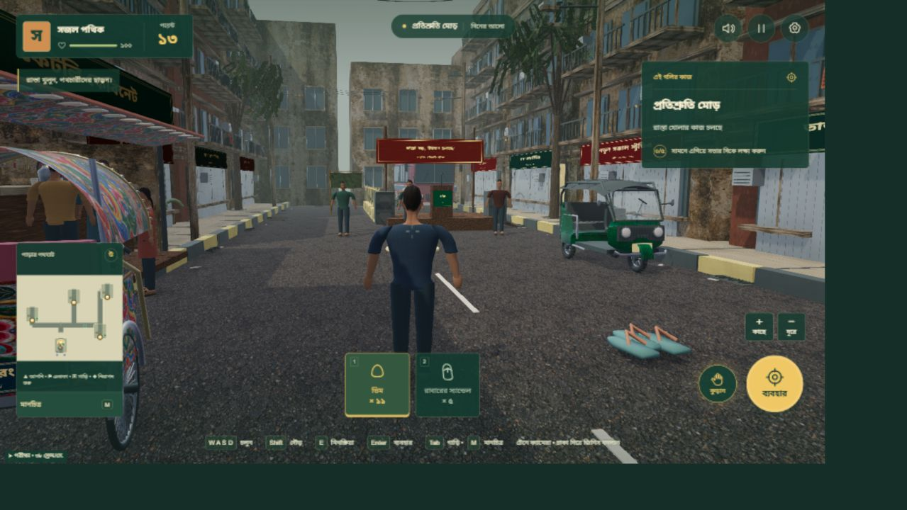
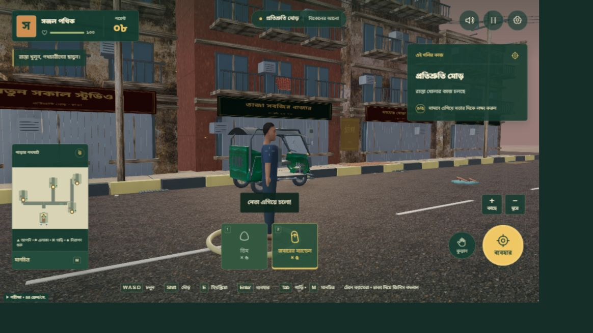
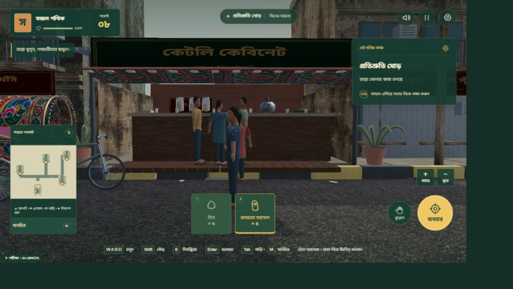

# Phase 01 production review — 2026-11-05

**The refreshed Dhaka street build is ready for the user's visual review.** The scoped gameplay and desktop/mobile viewport checks below were observed. Final art approval is pending; the desktop 60 FPS target and real Android performance are not verified. C–H are on hold per “1st complet phase 1”.

[Local production game](http://127.0.0.1:4302/) · [Run evidence](evidence/phase01-priority/) · [Asset provenance](../ASSETS.md)

The directory is the standalone `neta-uthche` TypeScript monorepo. Git reported no repository. The C10 source/build checkpoint is [preserved separately](snapshots/phase01-priority-20261105-103646/manifest.json) and frozen B stays on port 4300. The prior C play tab was observed paused, with its original progress intact. The 4302 review used a separate browser origin. No player data, published content, uploads, unrelated application or database was reset or changed.

The street retains the photographic reference inspired asphalt/plaster, floral rickshaw, green CNG and detailed **কেটলি কেবিনেট**. This pass adds ribbed roof water tanks, pipes and woven gamchas that fold over balcony railings. The character has three distinct face shapes, fitted sleeves, a braided hair option, painted facial coloration and a skin micro-normal, while keeping the nine original animation clips and 17-joint bind pose. The character is partly stylized; approval of the semi-realistic art is for the user to judge from gameplay. The attached photos are references, with no real face or political emblem incorporated.

Meshy sign-in and balance were verified. Both creation requests were refused because the vendor's free plan does not allow API task creation. Balance stayed 100 and no task or credit charge was recorded. The shipped facial surfaces use a locally adapted [MakeHuman CC0 asset](https://static.makehumancommunity.org/about/license.html). No Meshy generation was needed for this result.

| Scope | Current production observation |
| --- | --- |
| Checks and build | Typecheck, lint, 130/130 tests, both production builds passed. Game entry `index-BNKCBhuC.js`, 3D bundle `game-BJTbjT_w.js`. [Log](evidence/phase01-priority/final-verification.txt) |
| Perspective, rig and cast | Perspective camera reported true; actual runtime listed 1 player, 1 fictional leader, 3 workers and 5 civilians. Walk, Run, Pickup and Throw appeared in the run. Regression checks compare the revised mesh's bind pose and all nine animation payloads with the original. |
| Desktop movement, pickups and physics | Keyboard walked and ran from the safe spawn to the main street. Both items added six to inventory. An actual Havok sandal launch used one and hit Montu for +8. [Launch](evidence/phase01-priority/desktop-launch.json) · [Hit](evidence/phase01-priority/desktop-throw-result.json) |
| World and camera collision | Forward X stopped at −2.978945 m at the rickshaw on both presses; 2.2 mm of tangential slide was measured. A tea-shop obstruction retracted the camera from 4.8 m to 0.05 m, fading the avatar; moving clear restored approximately 4.81 m and full opacity. [Movement](evidence/phase01-priority/desktop-world-collision.json) · [Retraction](evidence/phase01-priority/desktop-camera-retraction.json) · [Recovery](evidence/phase01-priority/desktop-camera-recovery.json) |
| Mobile controls | At 390×845 CSS pixels, actual joystick input moved from (−3.08, 0.21) to (−1.44, −5.01) in X/Z. The pickup button raised eggs from 6 to 12; a scene drag changed yaw; use reduced eggs to 11. That projectile hit Komol for +5. [Touch evidence](evidence/phase01-priority/mobile-throw.json) · [Hit and final state](evidence/phase01-priority/mobile-final.json) |
| Bengali and interface | `lang=bn-BD`, bundled Noto Sans Bengali ready, no replacement character in rendered text, and no horizontal overflow at the two measured viewport sizes. HUD, minimap and expanded map, mission, দোকান signs and subtitles were inspected. Bengali sample includes স্বাধীনতা, প্রতিশ্রুতি, ক্ষুদ্র, শ্রদ্ধা, দৃষ্টি, কর্মী, র‍্যাফেল and কৌতুক! [Desktop](evidence/phase01-priority/bengali-desktop.jpg) · [Mobile](evidence/phase01-priority/bengali-mobile.jpg) |
| Light, PBR and quality | Selected Desktop High and Mobile Medium, and changed Day → Evening → Day in gameplay. HDR reported ready and 163 enabled shadow casters in the final desktop sample. The day street, warm evening and tea-shop views were captured. |
| Traffic and positional audio | Live Web Audio was running, with the published audio catalog, nonzero output and traffic/CNG loops plus bell, tea, bus, footsteps and throw/hit cues. Escape paused the game and suspended the context. This is playback evidence; a new subjective mix/listening assessment was not performed. [Runtime](evidence/phase01-priority/desktop-final.json) · [Pause](evidence/phase01-priority/desktop-pause.json) |

## Measured performance

Foreground Chromium WebGL 2 using Intel graphics on the development PC. Samples count rendered frames over elapsed time; these are steady-view observations, not device or sustained-load benchmarks.

| View | Profile | Frames / time | FPS |
| --- | --- | --- | ---: |
| 1280×720 CSS desktop street | Desktop High, day | 600 / 15.5302 s | 38.63 |
| 390×845 CSS mobile street | Mobile Medium, day | 600 / 10.2103 s | 58.76 |

[Desktop sample](evidence/phase01-priority/desktop-final.json) · [Mobile sample](evidence/phase01-priority/mobile-final.json). The mobile result is from a viewport on this PC. The desktop 60 FPS target remains open. The browser capture includes an outer margin from the preview surface; the DOM measurements record the actual game viewport.

## Gameplay angles

[Character front](evidence/phase01-priority/character-front.jpg) · [Mobile gameplay](evidence/phase01-priority/mobile-gameplay.jpg)

Stop here for visual approval. Existing A–C functionality is preserved; no D–H work was started in this pass.
