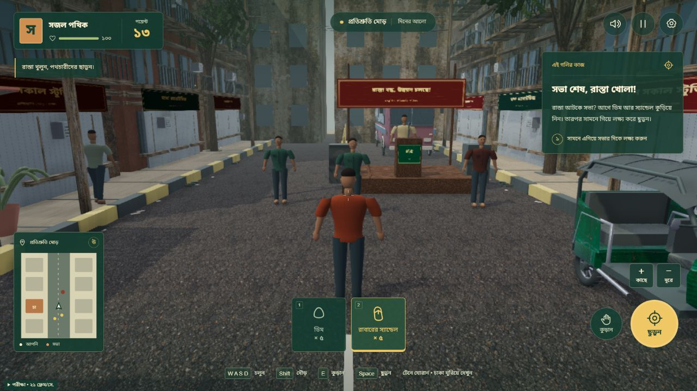
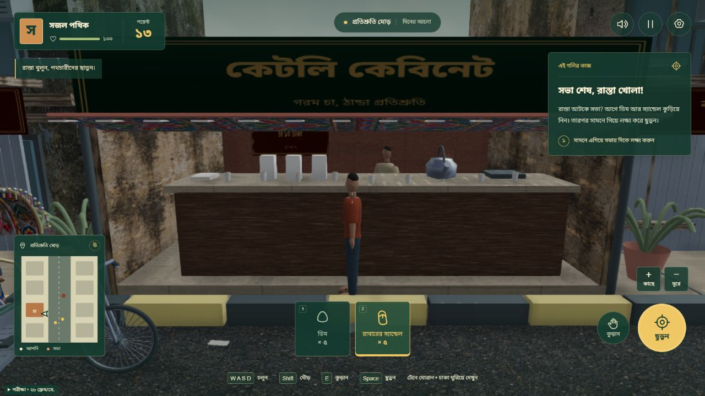
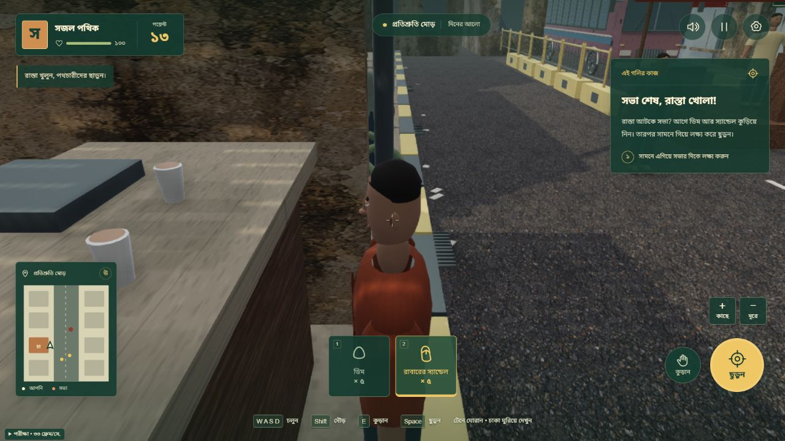

# Phase 00–01: বর্তমান যাচাই ও খোলা গেট

> ঐতিহাসিক প্রতিবেদন। ৫ নভেম্বরের নতুন চরিত্র, বর্তমান build ও desktop/mobile প্রমাণ: [Phase 01 production review](phase-01-20261105-review.md)।

**Phase 00 যাচাই হয়েছে। Phase 01 খেলাযোগ্য, কিন্তু বর্তমান সম্পূর্ণ acceptance gate পাস হয়নি।** শেষ mobile পরীক্ষা ও শেষ prop পরিবর্তনের পর ছবি যাচাই অসম্পূর্ণ। ব্যবহারকারী physical Escape দিয়ে Computer Use থামিয়েছেন; তারপর আর UI নিয়ন্ত্রণ করা হয়নি। পরবর্তী কোনো phase শুরু হয়নি।

খেলা: [স্থানীয় production preview](http://127.0.0.1:4173/)। Preview server আগে থেকেই চলছিল এবং একই প্রকল্পের নতুন `dist` সরবরাহ করছে; নতুন server বা অন্য প্রকল্পের service বন্ধ করা হয়নি। HTTP 200, বাংলা HTML এবং production asset bundle যাচাই হয়েছে।

## Phase 00

বর্তমান directory `D:/neta-udche -3d`, root package `neta-uthche`। এটি আগের স্বতন্ত্র গেম; clothing e-commerce বা অন্য application পাওয়া যায়নি। `git status --short --branch` জানিয়েছে এটি Git repository নয়। বিদ্যমান source/data সংরক্ষণ করা হয়েছে; কোনো database reset/delete বা অন্য প্রকল্প পরিবর্তন হয়নি।

`AGENTS.md`, `GOALS.md`, `PLANS.md`, `harness/build/phase-00.md` থেকে `phase-06.md` এবং build log আগে থেকেই ছিল। সেগুলো বজায় রাখা হয়েছে; resumption audit অনুযায়ী plan ও Phase 00 prerequisite সংশোধন হয়েছে। [API ও audit প্রমাণ](context/003-phase01-recheck.md)। Context7-তে official Babylon/Havok async WASM initialization, Physics V2 এবং Vite production/publicDir/preview API যাচাই করা হয়েছে। Live registry সংস্করণ installed versions-এর সঙ্গে মিলে গেছে: Babylon 9.33.1, Havok 1.3.14, Vite 8.3.5; Node v26.5.0।

## বাস্তবায়ন ও ফাইল

TypeScript npm monorepo: `apps/game`-এ Vite/React/Babylon/Havok, `packages/shared`-এ বাংলা content ও gameplay rules। `apps/admin` ও `apps/server` শুধু reserved boundary documentation; কার্যকর Admin, API, database বা multiplayer নেই।

একটি ঢাকার ব্লক, perspective third-person camera, ১৭-joint rigged GLB, ১ player, ১ কাল্পনিক leader, ৩ worker, ৫ civilian, কেটলি কেবিনেট, রিকশা, সবুজ CNG, static bus, pickups, physics projectiles, score/health, Bengali HUD/map/subtitles, daylight/evening, স্থানীয় HDR/PBR assets, shadows, synthesized spatial traffic audio ও quality presets আগে থেকেই বাস্তবায়িত। বিস্তারিত [graphics revision](graphics-upgrade.md) ও [asset provenance/licenses](../ASSETS.md)।

এই resumption-এ তৈরি/পরিবর্তিত প্রধান ফাইল:

| ফাইল | পরিবর্তন |
| --- | --- |
| `apps/game/src/frameStats.ts`, `tests/frame-stats.test.ts` | সময়ভিত্তিক FPS; hidden/resume gap বাদ; ৬০০ frame সীমা; ভুল arithmetic FPS average-এর বিরুদ্ধে test |
| `apps/game/src/game.ts` | quality/lighting-এ benchmark reset, runtime motion history, perspective diagnostics, shared zoom method; merged static geometry freeze ও মূল shadow-caster intent বজায় রাখা |
| `apps/game/src/main.tsx`, `style.css` | বাংলা কাছে/দূরে camera buttons, QA-only নতুন মাপ button, accidental gameplay text selection বন্ধ |
| `apps/game/src/world.ts` | সাদা box biscuit props-এর বদলে lathed transparent jars, biscuit stacks ও tin lids; stove burner/support; পেছনের window mullions/sills |
| `PLANS.md`, `harness/build/phase-00.md` | বিদ্যমান standalone কাজ সংরক্ষণ করে resumption-এর নিয়ম |
| `harness/context/003-phase01-recheck.md`, এই রিপোর্ট, `harness/build-log.md` | বর্তমান audit, actual evidence, অসম্পূর্ণ গেট |

Jar/stove/window সংশোধনের পর types/lint/tests/build সফল এবং গেম loading থেকে HUD-এ পৌঁছেছে। **সেই সর্বশেষ prop পরিবর্তনের কাছের appearance screenshot দিয়ে যাচাই করা যায়নি**; এটিকে visual pass ধরা হয়নি।

## পরীক্ষা ও বাস্তব প্রমাণ

সর্বশেষ সব gameplay/prop source পরিবর্তনের পরে `npm run verify`-তে **typecheck, lint, ৭/৭ tests এবং production build পাস**। [সম্পূর্ণ output](evidence/phase01-recheck-checks.txt)। GLB skin weights/clips, material/HDR budgets, civilian rewards, ballistic arc, collision, Unicode ও FPS গণনা পরীক্ষা হয়েছে। Vite-এর বড় 3D chunk advisory রয়ে গেছে (প্রায় ২.৬৭ MB, gzip ০.৬৩ MB); এটি build failure নয়।

এই turn-এর jar সংশোধনের আগের কার্যকর gameplay run-এ, একই movement/camera/physics code দিয়ে:

- W-এ হাঁটা এবং Shift+W-এ দৌড়; runtime motion history-তে Idle, Walk, Run, Pickup, Throw দেখা গেছে। [প্রমাণ](evidence/phase01-review/hits-run.json)।
- ডিমে +৫, স্যান্ডেলে আরও +৮, score=১৩; worker health প্রথমে ৭৫, পরে ৩৫। [স্যান্ডেলের flight](evidence/phase01-review/projectile-flight.jpg), [runtime](evidence/phase01-review/sandal-flight.json)। প্রথম pickup চেষ্টা দূরে থাকায় ব্যর্থ হয়েছিল; পরে কাছে গিয়ে ছয়টি পাওয়া গেছে। ব্যর্থ প্রথম চেষ্টা pass হিসেবে গণনা করা হয়নি।
- Counter-এ অতিরিক্ত A input-এ x=-৫.৬৯৯০২৫ অপরিবর্তিত। [collision](evidence/phase01-review/counter-collision.json)।
- ছাউনির কাছে nominal ৪.৮ মিটার camera থেকে target-distance প্রায় ১.৫৪৪৬ মিটারে সরে এসেছে; player দৃশ্যমান। [camera data](evidence/phase01-review/camera-collision.json), [ছবি](evidence/phase01-review/camera-collision.jpg)।
- বাংলা camera button-এ distance ৪.৮ থেকে ৪.২ হয়েছে; perspective=true। [zoom](evidence/phase01-review/zoom-teashop.json)।
- বাংলা HUD/mission, দোকানের “কেটলি কেবিনেট” ও subtitle দেখা গেছে। Desktop-এ NPC Walk ও স্থানীয় পোশাক উপস্থিত ছিল।

## FPS

নতুন পদ্ধতি: শেষ সর্বোচ্চ ৬০০টি visible frame-এর সংখ্যা × ১০০০ / মোট frame milliseconds। Quality/lighting বদলালে বা tab hidden হলে window reset হয়। Resume interval বাদ দেওয়া হয়। এটি আগের arithmetic mean পদ্ধতি থেকে আলাদা; পুরোনো সংখ্যার সঙ্গে সরাসরি তুলনা করবেন না।

| বর্তমান রেকর্ড | মাপ |
| --- | --- |
| Desktop street, ১২৮০×৭২০ | **২৩.৫৯ FPS**, ৬০০ frame, ২৫.৪৩ সেকেন্ড — [JSON](evidence/phase01-review/desktop-runtime.json) |
| Desktop tea-shop view | **২৩.২৬ FPS**, ৬০০ frame, ২৫.৮০ সেকেন্ড — [JSON](evidence/phase01-review/desktop-teashop-runtime.json) |
| সর্বশেষ prop build, নতুন mobile sample | **অসম্পূর্ণ** |

Chrome background/occlusion-এ প্রায় ১ FPS দেখা গেছে। সামনে থাকা in-app preview-তে প্রথম home reading প্রায় ৫৯ FPS ছিল; সেটি gameplay benchmark নয়। পরে browser control থেমে গেছে। উপরের automated-browser records-কে স্থায়ী foreground hardware benchmark বা ৬০ FPS target pass বলা হচ্ছে না। বাস্তব Android qualification হয়নি। আগের mobile evidence [graphics report](graphics-upgrade.md)-এ ঐতিহাসিক ফল হিসেবে আছে; সেটি বর্তমান build-এর নতুন mobile pass নয়।

## ছবি ও visual gate

এই turn-এ তিনটি gameplay angle সংরক্ষিত, **শেষ jar/stove/window prop edit-এর আগে**:

আগের revision-এর আরও তিনটি angle, daylight/evening, Bengali shaping ও ৩৯০×৮৪৪ mobile screenshots [graphics report](graphics-upgrade.md)-এ আছে। বর্তমান prop edit ও নতুন camera buttons-সহ নতুন mobile/তিন-angle set এখনো বাকি।

| Acceptance gate | অবস্থা |
| --- | --- |
| Standalone audit, harness, monorepo ও Context7 | যাচাই হয়েছে |
| Final-source types/lint/tests/build | পাস |
| Production server | স্থানীয়ভাবে চলমান, HTTP 200 |
| Desktop movement/animation/pickups/physics/collision | এই turn-এ actual evidence আছে; final prop-only edit-এর আগের gameplay run |
| Final build desktop load | Loading শেষে Bengali HUD দেখা গেছে |
| Final build mobile/presets/Bengali shaping regression | অসম্পূর্ণ; নতুন browser check বাকি |
| Final prop appearance ও fresh screenshot set | অসম্পূর্ণ |
| Visible placeholder-free polished semi-realistic art | **অনুমোদিত নয়**; final appearance inspection ও ব্যবহারকারীর visual approval বাকি; চরিত্র এখনো stylized |
| Stable desktop 60 / real Android 30 FPS | প্রমাণিত নয় |
| Later phases | শুরু হয়নি |

Computer Use-এ একাধিক timeout-এর পরে connection reset করে inventory পাওয়া যায়। সেটি স্পষ্টভাবে জানিয়েছে ব্যবহারকারী physical Escape দিয়ে Computer Use থামিয়েছেন। তারপর আর browser/native UI call করা হয়নি। সর্বশেষ temporary viewport ১২৮০×৭২০; interruption-এর পরে reset যাচাই করা হয়নি। Existing played Chrome tab-এর progress reset/delete করা হয়নি।

**Phase 01 complete বলা হচ্ছে না।** অবশিষ্ট কাজ হলো browser সংযোগ পাওয়া গেলে final prop inspection, নতুন mobile/preset/shaping run, fresh তিন-angle capture ও নির্ভরযোগ্য foreground FPS qualification; তারপর visual approval। Phase 02–06-এর জন্য আলাদা অনুমোদন লাগবে।
