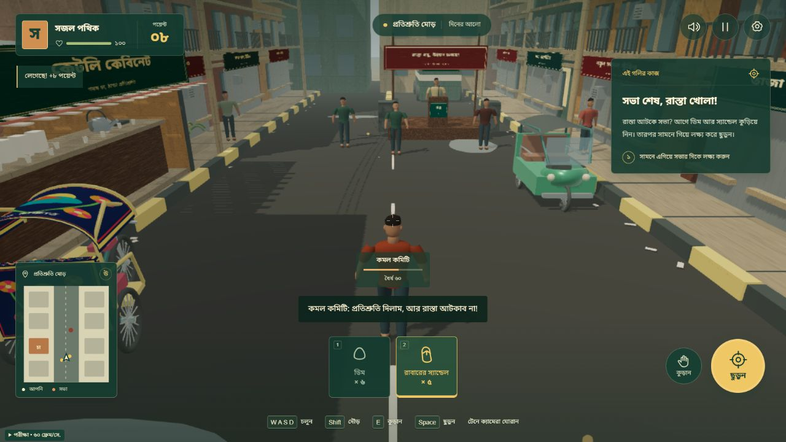
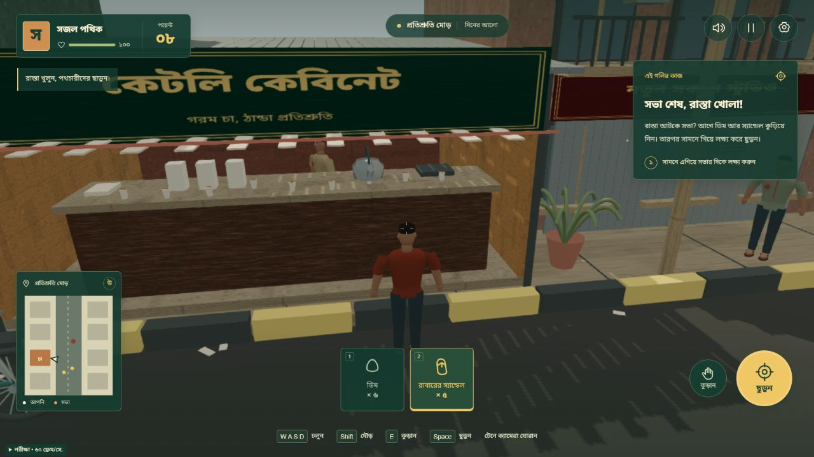
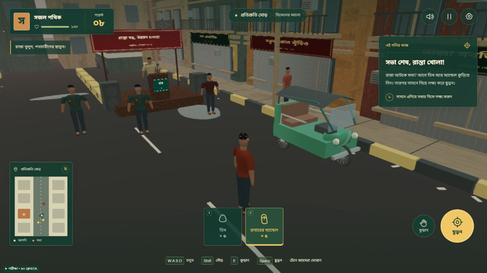

# Phase 00–01: বাস্তব ফলাফল

> সর্বশেষ অবস্থা: [Phase 01 production review, ৫ নভেম্বর](phase-01-20261105-review.md)। নিচের বিবরণ ঐতিহাসিক।

> এটি প্রথম vertical-slice-এর সংরক্ষিত রিপোর্ট। ছবি-ভিত্তিক নতুন গ্রাফিক্স ও চরিত্রের বর্তমান ফল দেখুন [graphics-upgrade.md](graphics-upgrade.md)। নিচের FPS ও পাঁচ-animation বিবরণ ঐতিহাসিক ফল।

## অবস্থান

**Phase 00 সম্পন্ন। Phase 01-এর খেলাযোগ্য প্রযুক্তিগত সংস্করণ তৈরি ও পরীক্ষা হয়েছে; চূড়ান্ত শিল্পমানের অনুমোদন বাকি।** বর্তমান চরিত্র ও যানবাহন স্টাইলাইজড। এগুলোকে সংযুক্ত নির্দেশনার চূড়ান্ত বিশ্বাসযোগ্য, semi-realistic শিল্পমান হিসেবে ঘোষণা করা হচ্ছে না। পরের কোনো ধাপ শুরু করা হয়নি।

খেলা: [স্থানীয় প্রোডাকশন সংস্করণ](http://127.0.0.1:4173/)। পুনরায় চালাতে মূল ফোল্ডারে `npm run build` এবং `npm run preview`।

## তৈরি কাজ ও স্থাপত্য

শুরুতে ফোল্ডার খালি ছিল, Git repository ছিল না। সব প্রকল্প ফাইল নতুন; অন্য কোনো অ্যাপ বা ডেটাবেস পরিবর্তিত হয়নি। সম্পূর্ণ তালিকা `evidence/files.txt`-এ।

| অংশ | তৈরি ফাইল ও দায়িত্ব |
| --- | --- |
| নিয়ম ও পরিকল্পনা | `AGENTS.md`, `GOALS.md`, `PLANS.md`, `README.md`, `ASSETS.md` |
| ধাপের নথি | `harness/build/phase-00.md` থেকে `phase-06.md`, `harness/context/001-discovery.md`, `harness/build-log.md` |
| খেলার ইন্টারফেস | `apps/game/src/main.tsx`, `style.css`, বাংলা HTML, Vite configuration |
| ত্রিমাত্রিক খেলা | `game.ts`: camera, movement, animation blending, collision, Havok projectiles, health, score, pickups, quality presets |
| ঢাকার দৃশ্য | `world.ts`, `art.ts`: স্থাপত্য, দোকান, যানবাহন, মৌলিক PBR ও normal textures, বাংলা সাইনবোর্ড, রিকশার ছবি |
| শব্দ | `audio.ts`: নিজস্ব synthesised traffic, positional engine hum, horns; কোনো কণ্ঠ নকল নেই |
| Babylon সংযোগ | `engine.ts`: প্রয়োজনীয় module imports; অপ্রয়োজনীয় editor/XR/flow graph বাদ |
| অভিন্ন নিয়ম | `packages/shared/src/index.ts`: বাংলা কনটেন্ট, নাম, স্কোর, চলার সীমা, ballistic launch, quality configuration |
| সম্পদের উৎস | `assets/source/generate.mjs`; `public/assets/models/dhaka-character.glb` |
| পরীক্ষা | `tests/rules.test.ts`, `tests/assets.test.ts` |
| পরের ধাপের স্থান | `apps/admin/README.md`, `apps/server/README.md`; কার্যকর Admin/API/multiplayer তৈরি হয়নি |
| টুল ও সংস্করণ | root/workspace package files, lockfile, TypeScript ও ESLint configuration, `scripts/harness.mjs` |

Babylon.js 9.33.1, Havok 1.3.14, Vite 8.3.5, React এবং TypeScript ব্যবহার হয়েছে। Context7 দিয়ে বর্তমান API এবং npm দিয়ে package নাম/সংস্করণ যাচাই হয়েছে। Colyseus ভবিষ্যৎ ধাপের জন্য যাচাই করা হয়েছে, ইনস্টল করা হয়নি।

## সম্পদ ও লাইসেন্স

চরিত্র, রিকশা, সিএনজি, দোকান, পরিবেশ, পোশাকের বুনন, সাইনবোর্ড, floral art, SVG ও synthesised sound এই প্রকল্পের নিজস্ব কাজ। চরিত্রে ১৭টি joint ও Idle/Walk/Run/Throw/Hit—পাঁচটি animation clip আছে। GLB প্রায় ০.৬৭ MB; পুনর্গঠনযোগ্য উৎস সঙ্গে রয়েছে। একই মূল শরীর থেকে চরিত্রের রঙভেদ তৈরি হয়েছে। Blender ফাইল নেই; parametric source রয়েছে।

Noto Sans Bengali: SIL OFL 1.1। Babylon: Apache-2.0। npm-এর Babylon Havok package: MIT। প্রয়োজনীয় notice/license `public/assets/licenses/`-এ আছে। বিস্তারিত `ASSETS.md`-এ। কোনো real politician, মুখ, দলীয় চিহ্ন, রেকর্ড করা কণ্ঠ বা বাইরের artwork ব্যবহার হয়নি।

## যাচাই ও গ্রহণযোগ্যতার অবস্থা

| শর্ত | বাস্তব ফল |
| --- | --- |
| Read-only audit ও build harness | পাস; খালি standalone directory নিশ্চিত করার পর লেখা শুরু |
| এক ব্লক ও কেটলি কেবিনেট | তৈরি; kettle/cups/counter/bench/roof/signs এবং facade/wires/curbs/puddles দৃশ্যমান |
| Rigged GLB ও তৃতীয়-ব্যক্তি camera | পাস; runtime-এ ১০টি skeleton ও ৫০টি cloned animation group |
| হাঁটা ও দৌড় | বাস্তব keyboard input-এ পরীক্ষা; প্রায় ২.২৫ ও ৪.৫ মিটার/সেকেন্ড |
| Camera collision | ছাদে খেলোয়াড় ঢেকে যাওয়ার সমস্যা পাওয়া ও ঠিক করা হয়েছে; roof/awning/sign proxies দিয়ে close view পরীক্ষা |
| ১ নেতা, ৩ কর্মী, ৫ পথচারী | দৃশ্যে উপস্থিত; প্রত্যেকের কাল্পনিক বাংলা নাম |
| ১ রিকশা ও ১ সবুজ সিএনজি | নিজস্ব বহু অংশের mesh; রিকশায় floral artwork, সিএনজিতে বাংলা plate |
| ডিম ও স্যান্ডেল সংগ্রহ | keyboard ও mobile button-এ ছয়টি করে পাওয়া পরীক্ষা |
| অ্যানিমেশনসহ projectile ও hit | বাস্তব throw পরীক্ষা; স্যান্ডেলে +৮, ডিমে +৫; health কমেছে |
| পথচারীর পুরস্কার | domain test-এ শূন্য; runtime warning/health penalty implemented; চূড়ান্ত run-এ civilian hit আলাদা করে পরীক্ষা হয়নি |
| World collision | কাউন্টারে অতিরিক্ত এক সেকেন্ড চললেও অবস্থান অপরিবর্তিত; `collision.json` |
| বিরতি | `pause-retry.json`-এ paused=true, audio=suspended, আগে/পরে একই অবস্থান |
| Mini-map ও বাংলা HUD | desktop ও ৩৯০×৮৪৪ viewport-এ দেখা হয়েছে |
| দিন/বিকেল ও মান নির্বাচন | বাস্তব নির্বাচনে আলো ও renderer settings বদলেছে; pressed state-ও পরীক্ষা |
| Traffic audio | Web Audio context running ও pause-এ suspended দেখা গেছে; মানুষের কানে audio mix মূল্যায়ন করা হয়নি |
| বাংলা Unicode | desktop/mobile-এ যুক্তাক্ষর, কার, ফলা ও punctuation sample দেখা হয়েছে; U+FFFD নেই; `lang=bn-BD` |
| বাংলা সাইনের দিক | পাশের plane-এর mirrored text পাওয়া ও orientation ঠিক করে কেটলি কেবিনেট সামনে থেকে পড়া যাচাই |
| Mobile controls | joystick ধরে অবস্থান বদল, pickup এবং throw বোতামে +৮ পরীক্ষা; বাস্তব Android নয় |
| Types/lint/tests/build | সবশেষ source change-এর পরে পাস; ৫/৫ tests; `evidence/checks.txt` |
| তিনটি gameplay কোণ | নিচের তিনটি JPG তৈরি |
| Debug primitive | দৃশ্যে collider box/capsule/debug marker নেই; renderable জিনিসের নিজস্ব mesh/material আছে |
| চূড়ান্ত semi-realistic শিল্পমান | **খোলা**: বর্তমান মানুষ ও গাড়ির আকৃতি বেশি স্টাইলাইজড; উচ্চমানের final art-এর সমতুল্য নয় |
| Production readiness | দাবি করা হয়নি; real-device qualification ও release review পরের অনুমোদিত ধাপের বিষয় |

## মাপা গতি

| পরীক্ষা | পর্দা ও মান | পর্যবেক্ষণ |
| --- | --- | --- |
| Desktop street | ১২৮০×৭২০, desktop | গড় **৫৯.৩৬ FPS**, ৬০০টি frame sample |
| Desktop evening/CNG | ১২৮০×৭২০, desktop | গড় **৫৯.৯৫ FPS**, ৬০০টি sample |
| Mobile viewport | ৩৯০×৮৪৪, mobile | গড় **৫৯.৯৮ FPS**, ৬০০টি sample |
| বাস্তব Android | পরীক্ষা হয়নি | ৩০ FPS target পূরণ হয়েছে বলে দাবি করা হচ্ছে না |

এগুলো একই স্থানীয় কম্পিউটারের in-app browser-এর ফল। ফোনের CPU/GPU, touch hardware, thermal বা battery test নয়। আগের iteration-এ প্রায় ৫৬ FPS পাওয়া গিয়েছিল; zero-weight animation বন্ধ, দূরের ছোট mesh detail ও shadow work কমানোর পরে উপরের মাপ পাওয়া যায়।

পদ্ধতি: সক্রিয় খেলার প্রতি frame-এ Babylon `Engine.getFps()` sample নিয়ে শেষ ৬০০টির arithmetic mean। এটি প্রায় দশ সেকেন্ডের steady-view পর্যবেক্ষণ, দীর্ঘ পুরো খেলার benchmark নয়। ব্রাউজার লুকানো থাকলে background throttling দেখা গেছে; সেই সময়কে সক্রিয় gameplay performance হিসেবে ব্যবহার করা হয়নি।

## ছবি

অতিরিক্ত: `desktop-home.jpg`, `desktop-settings.jpg`, `mobile-home.jpg`, `mobile-gameplay.jpg`, `mobile-settings.jpg`, `bengali-shaping-desktop.jpg`, `bengali-shaping-mobile.jpg`, `camera-roof-fixed.jpg`।

## সীমাবদ্ধতা ও পরের ধাপ

- মানুষ/যানের final art fidelity এবং চরিত্রের বৈচিত্র্য এখনও শিল্প-পর্যালোচনা দরকার। Animation blending আছে; production mocap, foot IK এবং বিভিন্ন rig নেই।
- হাঁটার world collision সহজ footprint/height logic; projectile-এ বাস্তব Havok Physics V2। Vehicle driving নেই।
- Palette-based environment probe ও procedural texture ব্যবহৃত; photographed HDR environment বা scanned PBR set নয়।
- WebGL প্রয়োজন। বাস্তব Android, অন্য GPU, দীর্ঘ সেশন ও subjective audio mix যাচাই হয়নি।
- Vite-এর lazy-loaded 3D chunk প্রায় ২.১ MB uncompressed / ০.৫০ MB gzip; build একটি size advisory দেয়। এটি build failure নয়।
- Runtime dependency audit-এ শূন্য vulnerability পাওয়া গেছে; development tools-এর install audit-এ ১১টি moderate advisory ছিল। Phase 06-এর security review সম্পন্ন বলা হয়নি।
- পূর্ণ combat/AI/newspaper (02), শহর/driving/weather (03), কার্যকর বাংলা Admin ও content publishing (04), lobby/multiplayer/referrals (05), release/device QA (06) করা হয়নি। এগুলোর বাংলা ভাষার বাধ্যবাধকতা harness-এ লেখা আছে।

**এখানেই Phase 01 review gate। পরের ধাপের অনুমোদন ধরে নেওয়া হয়নি।**
